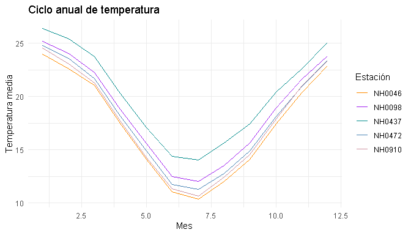

<!-- README.md is generated from README.Rmd. Please edit that file -->

# estaciones


<!-- badges: start -->

[](https://lifecycle.r-lib.org/articles/stages.html#experimental)
[](https://github.com/maximoortenzi/estaciones/actions/workflows/R-CMD-check.yaml)
[](https://app.codecov.io/gh/maximoortenzi/estaciones)
<!-- badges: end -->

El paquete `estaciones` reúne funciones para descargar, leer, resumir y
graficar los datos meteorológicos de las estaciones del INTA.

Incluye los datos de cinco estaciones de la provincia de Santa Fe
(Oliveros, Las Rosas, Zavalla, Rafaela y Reconquista) y los metadatos de
las 258 estaciones disponibles en el repositorio del libro *Introducción
a la Programación II*.

## Instalación

Podés instalar la versión en desarrollo desde GitHub con:

``` r
# install.packages("devtools")
devtools::install_github("maximoortenzi/estaciones")
```

## Ejemplo

Descargá y leé los datos de una estación a partir de su identificador:

``` r
library(estaciones)

datos_estacion("NH0437", "datos/NH0437.csv")
```

Si no querés descargar nada, el paquete ya trae los datos de las cinco
estaciones. Con ellos podés calcular la media y el desvío estándar de la
temperatura de cada estación:

``` r
library(estaciones)

tabla_resumen_temperatura(estaciones, temperatura_abrigo_150cm)
#> # A tibble: 2 × 6
#>   variable NH0046 NH0098 NH0437 NH0472 NH0910
#>   <chr>     <dbl>  <dbl>  <dbl>  <dbl>  <dbl>
#> 1 media     17.3   18.6   20.2   18.0   17.7 
#> 2 desvio     5.90   5.98   5.77   5.94   6.12
```

Y graficar el ciclo anual de temperatura:

``` r
grafico_temperatura_mensual(
  estaciones,
  colores = c("darkorange", "purple", "cyan4", "steelblue", "pink3"),
  titulo = "Ciclo anual de temperatura"
)
```



## Autores

- Máximo Ortenzi
- Santiago Ramuchio

## Cómo contribuir

Para contribuir con este paquete podés leer la [guía de
contribución](.github/CONTRIBUTING.md).

Tené en cuenta que el proyecto `estaciones` se publica con un [Código de
Conducta para Contribuyentes](CODE_OF_CONDUCT.md). Al contribuir con
este proyecto aceptás respetar sus términos.
